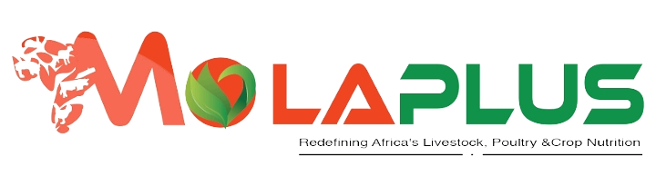
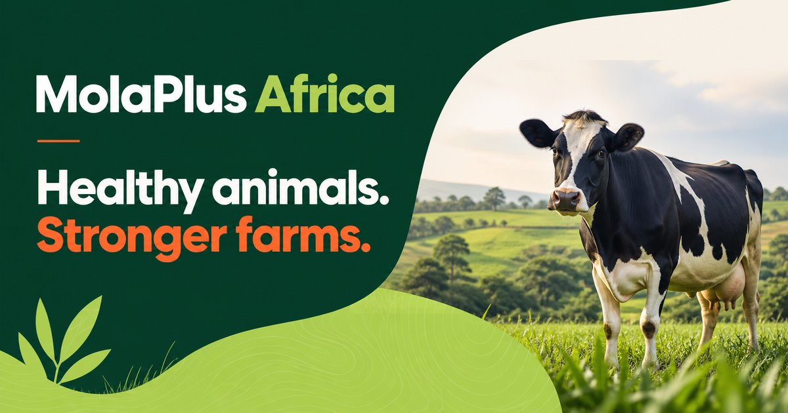
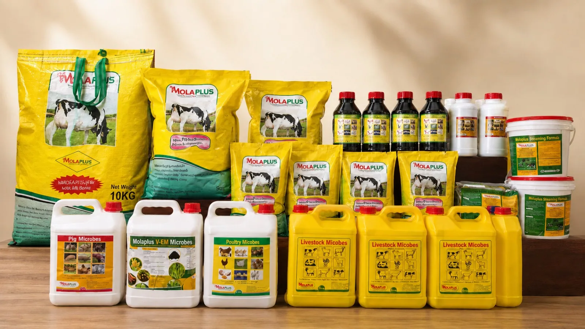

<p align="center">
  
</p>

<h3 align="center">Healthy animals. Stronger farms.</h3>

<p align="center">
  Advanced animal nutrition for productive African farms.<br/>
  <a href="https://molaplus.org"><b>molaplus.org</b></a> &nbsp;·&nbsp; English &nbsp;|&nbsp; Français
</p>

<p align="center">
  
</p>

---

## About MolaPlus

MolaPlus makes feed supplements, probiotics and crop nutrition for dairy, poultry and pig farmers. Its products aim to improve gut health, feed conversion and yields. The company also offers consultancy, training and technical support, so farmers get results from the product *and* from how they farm.

MolaPlus is based in Kenya and has a branch in **Côte d'Ivoire**. That's why the whole website can be read in **English or French**: use the EN / FR switch in the header.

**What we stand for:** Quality · Innovation · Reliability

---

## Products

| | Range | Pack sizes |
|---|---|---|
| 🥛 | **Super Milk Booster** — dairy supplement for more milk | 1 kg · 2 kg · 5 kg |
| 🐔 | **Poultry Microbes** — probiotic for healthier, stronger flocks | 500 ml · 1 L · 5 L · 10 L |
| 🐖 | **Pig Microbes** — probiotic for pigs and livestock | 1 L · 5 L · 10 L · 20 L |
| 🐄 | **Dairy Ultra Mineral Lick · Early Calf‑Weaner Meal · Bovine Meal · Steaming Formula** | various |
| 🥚 | **MolaPlus Layer Mash** | 50 kg |
| 🌱 | **Mazao Cereals · Mazao Organic Fertilizer · V‑EM Mbolea** — crop nutrition | various |

<p align="center">
  
</p>

---

## What you can do on the website

- 🛒 **Order online.** Choose your products and delivery location, and the team confirms price and delivery with you.
- 📍 **Find a stockist.** Search 3,800+ distributors by town, or sort them by distance from where you are.
- 🧑‍🌾 **Book a consultation.** Get nutrition and herd-management advice for your farm.
- 📚 **Read Field Notes.** Practical farming articles, from feeding routines to poultry-house checklists.
- ⚖️ **Compare products.** See which product fits which animal and goal.
- 🌍 **Read in English or French.**

---

## Contact

| | |
|---|---|
| 📞 Phone / WhatsApp | **+254 724 968 847** |
| ✉️ Email | **info@molaplus.org** |
| 💳 M‑Pesa | **Till No. 906520** |
| 🌐 Web | **[molaplus.org](https://molaplus.org)** |

---

<details>
<summary><b>For the web team: running and publishing the site</b></summary>

<br/>

**Built with:** Next.js (static export) · React · Tailwind CSS on the front, PHP + MySQL on Bluehost for orders, blog comments and the publishing studio (see [`backend/README.md`](backend/README.md)).

**Preview locally** (Node.js 24+):

```powershell
npm install
npm run dev
```

**Publish to Bluehost.** One command builds the site, backs up the live copy and uploads the new one. It asks for your SSH key passphrase.

```powershell
.\scripts\deploy.ps1            # website only
.\scripts\deploy.ps1 -Backend   # website + PHP API
.\scripts\rollback.ps1          # list backups, or restore one with -Stamp
```

**Bluehost CDN.** Bluehost serves the site through its built-in CDN (it runs on Cloudflare's network; there is no separate Cloudflare account). The server tells the CDN never to store pages (`.htaccess`), so a deploy shows up straight away; images, CSS and JS stay cached for speed. If an old version ever lingers, clear it in Bluehost: **Websites → molaplus.org → Settings → Performance → CDN → Purge All**.

**Settings and secrets** live in a single `.env` file (never committed) and in the server's `molaplus-config.php`.

**Blog editors** sign in at `/studio`. To create a login on the server: `php backend/sql/create-admin.php you@example.com "Your Name"`.

**French translation** uses Google's website translator, with the EN / FR switch in the header. The language you pick is remembered across pages.

**Backups.** Each deploy keeps the last five site snapshots in `~/backups/` on the server. Back up the database from cPanel → phpMyAdmin → Export.

</details>

<p align="center"><sub>© MolaPlus · Advanced Animal Nutrition</sub></p>
